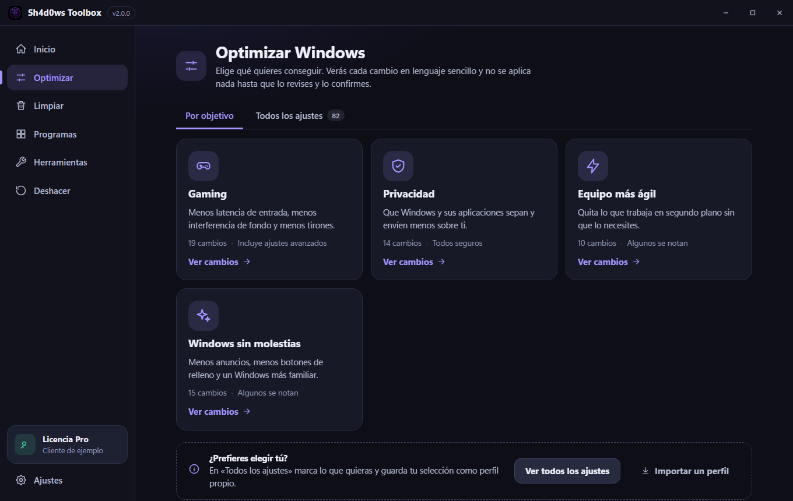
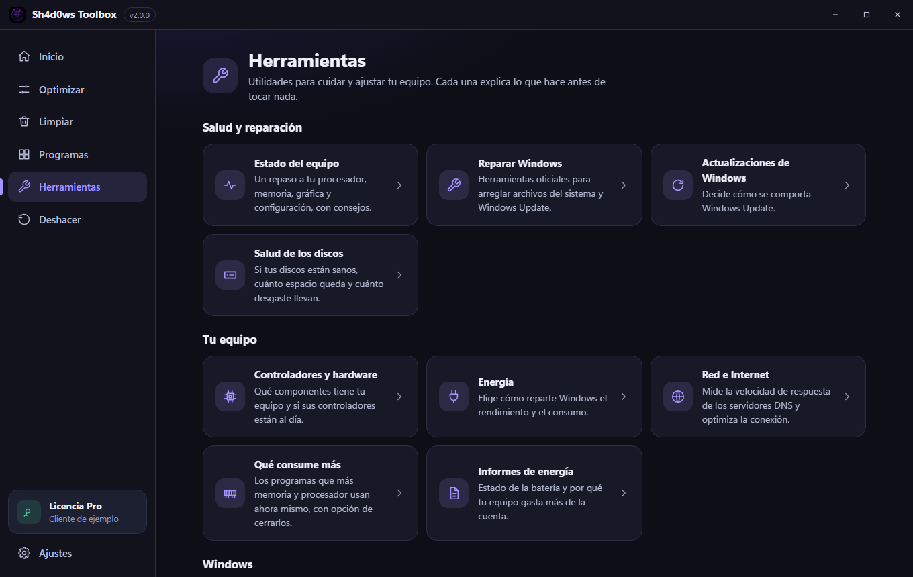
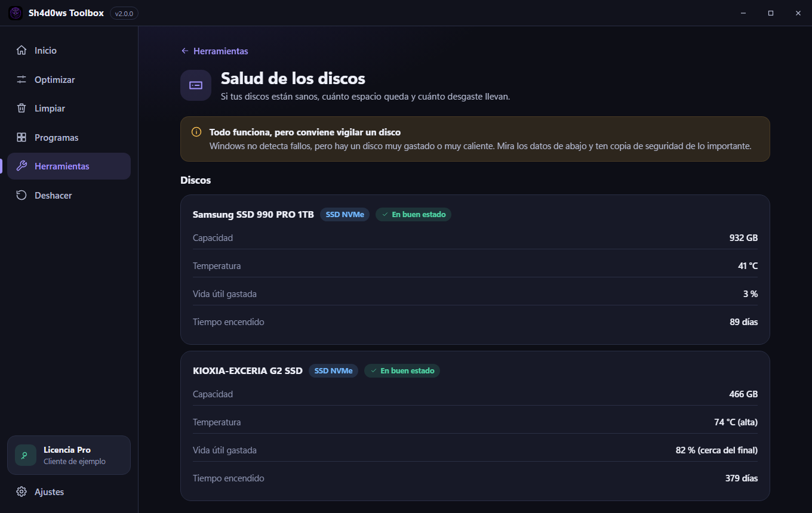
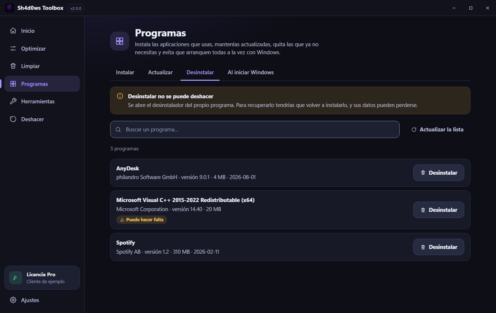
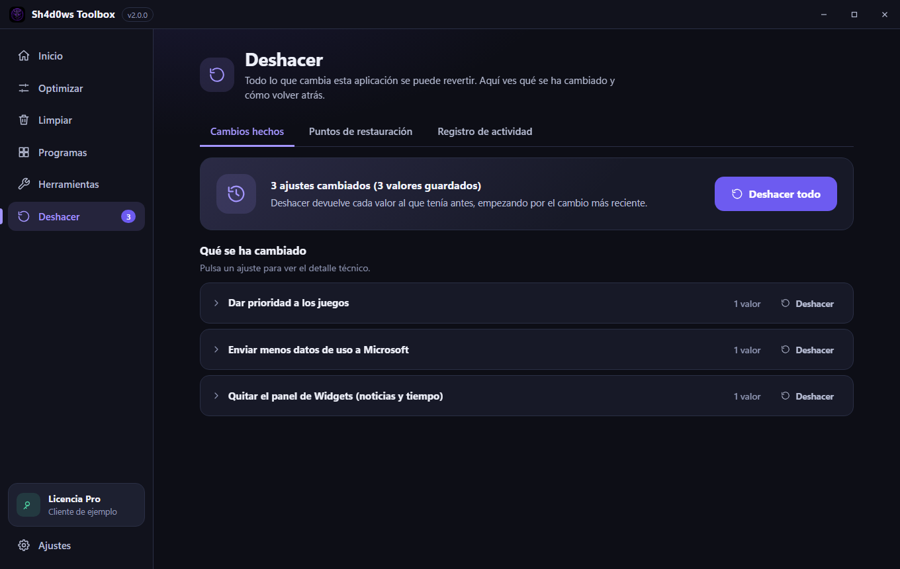
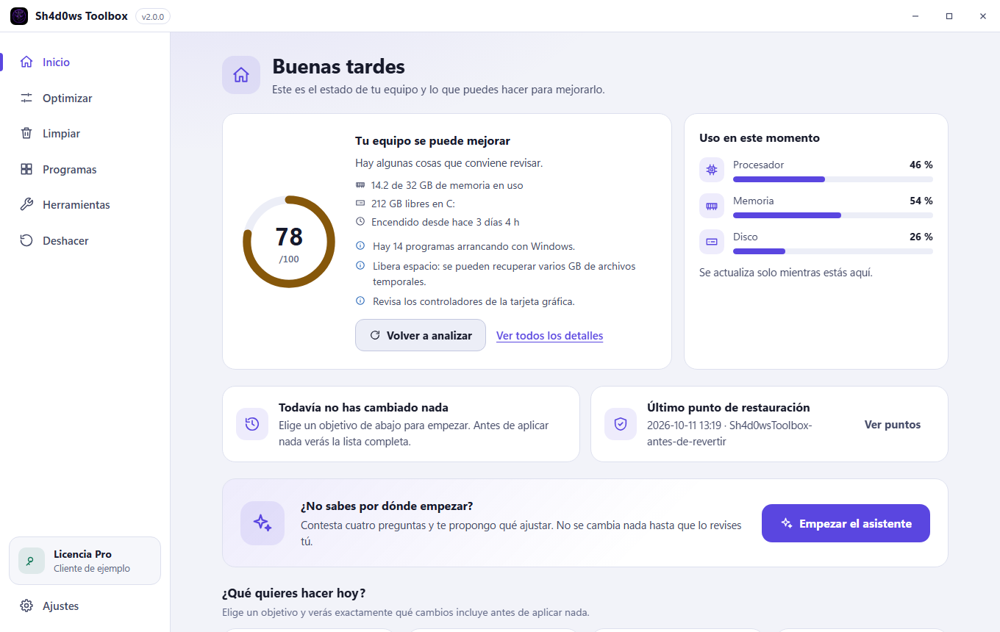
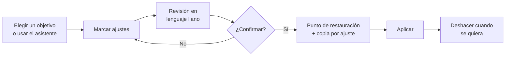
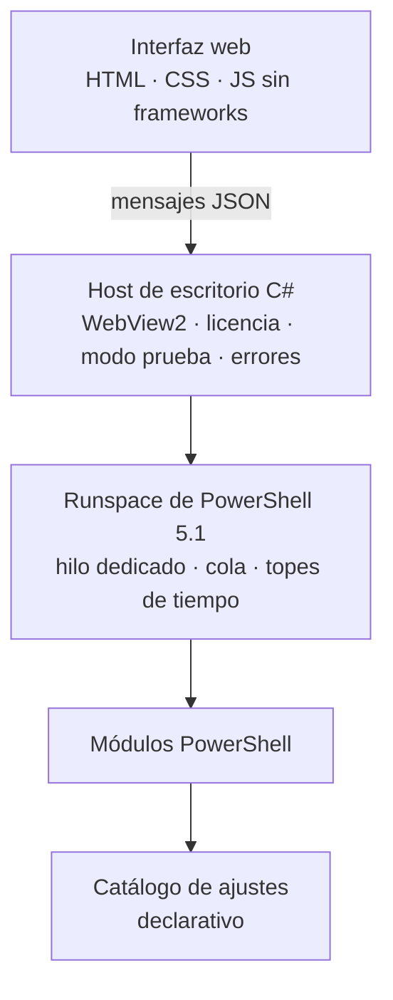

# Sh4d0ws Toolbox

**Optimizador de Windows 11, portable y de pago, pensado para quien no es técnico.** 
Un solo ejecutable · Todo se explica antes de aplicarse · Todo se puede deshacer

> **Este repositorio es un escaparate.** El código fuente es privado porque es software comercial
> (ver [LICENCIA.txt](LICENCIA.txt)). Aquí explico qué es, cómo está construido y qué decisiones de
> ingeniería hay detrás. Si estás evaluando mi trabajo, puedo enseñar el código en una revisión en directo.

**Contenido:** [Qué es](#qué-es) · [Capturas](#capturas) · [Qué hace](#qué-hace) · [Cómo funciona un cambio](#cómo-funciona-un-cambio) · [Arquitectura](#arquitectura) · [Decisiones de ingeniería](#decisiones-de-ingeniería) · [Calidad](#calidad-y-pruebas) · [English](#english-summary)

---

## Qué es

Una aplicación de escritorio que mejora el rendimiento, la privacidad y la limpieza de Windows sin que el
usuario tenga que saber qué es una clave del registro. La mayoría de optimizadores aplican cambios a ciegas;
este parte de la idea contraria:

| Principio | Qué significa en la práctica |
|---|---|
| **Un solo fichero** | Un `.exe` de unos 3 MB, sin instalador ni carpetas que acompañar. Lleva dentro los módulos, la configuración, la interfaz y las librerías |
| **Nada se aplica solo** | Los objetivos y el asistente únicamente *marcan* ajustes. Aplicar es un paso aparte, con una pantalla de revisión |
| **Todo es reversible** | Copia de seguridad antes de cada cambio; se puede deshacer un ajuste, todos, o volver a un punto de restauración |
| **Modo prueba real** | Recorre todo lo marcado sin tocar absolutamente nada del sistema |
| **Lenguaje llano** | Cada ajuste explica qué hace, qué notarás y qué riesgo tiene, sin jerga |
| **Licencia sin conexión** | Firma criptográfica verificada offline y ligada al equipo. *Deshacer* nunca depende de la licencia |

## Capturas

| Optimizar por objetivos | Asistente de inicio |
|---|---|
|  |  |

| Herramientas | Salud de los discos |
|---|---|
|  |  |

| Desinstalar programas | Deshacer, ajuste a ajuste |
|---|---|
|  |  |

<b>Tema claro</b> (con contraste comprobado automáticamente: texto ≥ 4,5:1, controles ≥ 3:1)

## Qué hace

| Sección | Contenido |
|---|---|
| **Inicio** | Puntuación del estado del equipo, uso en vivo de procesador, memoria y disco, sugerencias y el asistente de inicio |
| **Optimizar** | 82 ajustes de privacidad, rendimiento, interfaz, servicios y limpieza, agrupados por objetivos (juegos, privacidad, equipo más ágil, Windows sin molestias) con su nivel de riesgo. Perfiles propios que se pueden exportar e importar |
| **Limpiar** | Analiza cachés y temporales y borra solo lo que el usuario marca |
| **Programas** | Instalar y actualizar con WinGet, desinstalar y decidir qué arranca con Windows |
| **Herramientas** | Estado del equipo, salud de los discos, qué programas consumen más, informes de batería y energía, servicios, controladores, red y DNS, Windows Update, reparación del sistema |
| **Deshacer** | Cambios hechos (revertibles uno a uno o todos), puntos de restauración y registro de actividad |

**Asistente de inicio.** Cuatro preguntas (uso del equipo, portátil o sobremesa, tipo de disco, molestias) y una
propuesta adaptada: en un portátil no toca los planes de energía; con un disco duro clásico evita lo que lo cargaría más.
Solo propone ajustes seguros, y nunca los aplica: el usuario los revisa antes.

## Cómo funciona un cambio

Los ajustes peligrosos exigen escribir una palabra de confirmación; los que no se pueden revertir llevan una
insignia y una confirmación aparte. Cerrar un programa o desinstalarlo se avisa como lo que es: irreversible.

## Arquitectura

- **Host en C#:** ventana sin bordes con WebView2, navegación cerrada a un único origen, política de licencia y de modo prueba aplicada en un punto único, y un contrato de errores uniforme.
- **Motor en PowerShell:** un runspace en un hilo dedicado que serializa todas las operaciones, con topes de tiempo por tipo de tarea y rechazo explícito cuando está ocupado.
- **Interfaz sin dependencias:** componentes propios, sin `innerHTML` con datos externos y con una política de seguridad de contenido estricta. Pensada para usarse con teclado y con lectores de pantalla.
- **Un solo fichero portable:** los recursos viajan incrustados y se vuelcan de forma idempotente junto al `.exe`, sin tocar nunca los datos del usuario.

## Decisiones de ingeniería

- **Seguro por construcción, no por confianza.** Ningún ajuste toca el sistema directamente: todos pasan por envoltorios que guardan la copia antes de escribir. El registro de deshacer solo almacena *nombres* de manejadores, nunca código ejecutable, así que un fichero manipulado no puede ejecutar nada.
- **Listas de protegidos.** Los procesos y servicios críticos de Windows, de seguridad y de la propia aplicación no se pueden cerrar ni cambiar desde la interfaz. Para desinstalar, la interfaz nunca envía comandos: envía un identificador y el motor vuelve a leer el comando del sistema.
- **Simulación de verdad.** El modo prueba no es un aviso en pantalla: toda la capa de escritura lo respeta y el host puede forzarlo desde el arranque.
- **Lenguaje llano con rigor.** Cada ajuste tiene un título y una explicación en términos de lo que el usuario nota, y los errores técnicos se traducen a frases comprensibles sin perder el detalle original.
- **Accesibilidad medida.** Una herramienta propia comprueba el contraste de la paleta en ambos temas en cada cambio de estilos.
- **Distribución verificable.** El empaquetado inspecciona lo incrustado byte a byte, prueba el ejecutable solo en una carpeta vacía y se detiene si algo no cuadra.

## Calidad y pruebas

El proyecto se prueba **sin tocar el sistema real**: 17 suites se ejecutan sobre una copia aislada, con un guardián
que bloquea cualquier llamada que modifique el equipo y que, al terminar, comprueba que el original no ha cambiado.
Cubren el catálogo, el motor de copia y deshacer, las licencias (con claves temporales), el contrato entre la interfaz
y el host, y las herramientas de sistema.

| | |
|---|---|
| Tamaño | Unas 26.000 líneas entre C#, PowerShell, JavaScript, CSS y configuración, más pruebas y herramientas de empaquetado |
| Ajustes | 82, cada uno con título, explicación y nivel de riesgo |
| Pruebas | 17 suites aisladas |
| Distribución | Un único `.exe` portable de ≈ 3 MB |

## Tecnologías

C# · .NET Framework 4.8 · WinForms · WebView2 · PowerShell 5.1 · JavaScript (vanilla) · HTML/CSS · criptografía RSA · WinGet · Windows (registro, servicios, planes de energía, DISM)

---

## English summary

**Sh4d0ws Toolbox** is a commercial, single-file, portable Windows 11 optimizer designed for non-technical users.
Where most tuning tools apply changes blindly, this one is built around the opposite principles:

- **Nothing is applied automatically.** Goals and the setup wizard only *tick* options; applying is a separate step behind a plain-language review screen.
- **Everything is reversible.** A backup is written before every change, with per-change undo, undo-all and system restore points.
- **A real dry-run mode** walks through everything without touching the system.
- **Offline licensing** with cryptographic signatures bound to the machine; undoing changes never depends on the license.
- **Safe by construction:** all writes go through backup wrappers, the undo log stores handler *names* (never executable code), and critical processes and services are protected.

**Stack:** a C# (.NET Framework 4.8) desktop host with WebView2, a single queued PowerShell 5.1 runspace, and a framework-free web UI with a strict content-security policy and automated contrast checks. It ships as one ~3 MB executable and is tested without touching the real system (17 isolated suites with a guard that blocks mutating calls).

The source code is private; this repository is a showcase. I'm happy to walk through the code in a live review.
